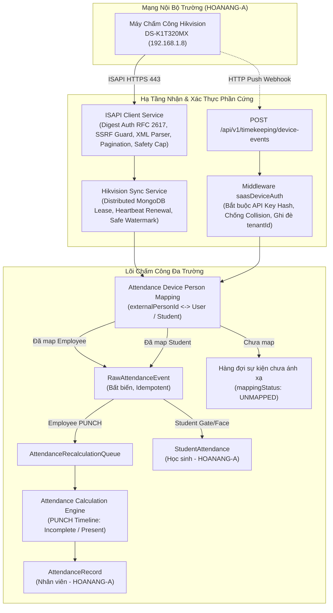

# BÁO CÁO NGHIỆM THU & BÀN GIAO TÍCH HỢP MÁY CHẤM CÔNG HIKVISION DS-K1T320MX VÀO HỆ THỐNG SAAS HOA NẮNG

- **Dự án**: Trường Mầm non Hoa Nắng (`E:\school-management-api`)
- **Phân hệ**: Zone 2 HR & Timekeeping / SaaS Hardware Ingest Engine
- **Thiết bị tích hợp**: Hikvision Face Recognition Terminal DS-K1T320MX
- **Trạng thái**: **ĐÃ HOÀN TẤT VÒNG NGHIỆM THU CUỐI CÙNG (100% UNIT, INTEGRATION, ROUTE GATING & FRONTEND BUILD PASS)**
- **Ngày cập nhật**: 21/11/2026

---

## I. THÔNG TIN THIẾT BỊ THỰC TẾ & MÔI TRƯỜNG MẠNG

### 1. Thông số thiết bị mục tiêu đã xác minh
- **Hãng sản xuất**: Hikvision
- **Model**: `DS-K1T320MX` (Nhận diện khuôn mặt & thẻ Mifare)
- **Địa chỉ IP nội bộ**: `192.168.1.8`
- **Port dịch vụ**:
  - HTTP Port: `80` (Thiết bị tự động chuyển hướng HTTP 301 sang HTTPS 443)
  - HTTPS Port: `443` (Cổng giao tiếp chính qua ISAPI)
  - SDK Port: `8000`
- **Firmware Version**: `V3.9.50 build 260130`
- **Giao thức chuẩn**: Hikvision ISAPI (Intelligent Security API), xác thực **Digest Authentication** (RFC 2617 / RFC 7616 với `qop="auth"`).
- **Múi giờ vận hành**: `Asia/Ho_Chi_Minh` (UTC+7, ISO format `+07:00`)
- **Tenant sở hữu**: `HOANANG-A`
- **Dữ liệu người dùng thử đã có trên thiết bị**:
  - Employee ID: `1`
  - Tên (Name): `LOC01`
  - Đã phát sinh sự kiện mẫu: `Authenticated via Face` (Mã sự kiện minor 75).

### 2. Cam kết và giới hạn an toàn phần cứng
- **Thiết bị `192.168.1.22` (Model DS-K1T320MFWX)**:
  - **TUYỆT ĐỐI KHÔNG TRUY CẬP, KHÔNG CẤU HÌNH, KHÔNG QUÉT MẠNG, KHÔNG ĐỒNG BỘ**.
  - Mã nguồn `hikvisionIsapiService.js` đã gắn chốt chặn cứng (`FORBIDDEN_IPS = ['192.168.1.22']`). Bất kỳ lệnh gọi nào tới IP này đều bị chặn ngay lập tức với mã lỗi `FORBIDDEN_DEVICE_IP` (HTTP 403).
- **An toàn TLS/HTTPS**:
  - Tuyệt đối không bật `NODE_TLS_REJECT_UNAUTHORIZED=0` toàn cục.
  - Sử dụng instance `https.Agent({ rejectUnauthorized: false, keepAlive: false })` nội bộ chỉ dành riêng cho kết nối socket tới thiết bị private LAN của trường.
- **Bảo mật sinh trắc học**:
  - **Chế độ kiểm tra chỉ đọc (Read-Only)**: Hệ thống tuyệt đối **không** tải ảnh khuôn mặt hay template sinh trắc học về cơ sở dữ liệu web.
  - Không ghi đè hay thay đổi người dùng, khuôn mặt, thẻ, cấu hình hay thời gian trên máy chấm công thật.

---

## II. KIẾN TRÚC TÍCH HỢP & BẢO MẬT ĐA TRƯỜNG (SAAS MULTI-TENANT)

Hệ thống hỗ trợ song song 2 luồng nhận diện: **ISAPI Pull Sync (Đồng bộ định kỳ/thủ công)** và **Hardware Push Webhook (Đẩy sự kiện thời gian thực)**.



### Các nguyên tắc cách ly dữ liệu & kiến trúc đã sửa dứt điểm:

1. **Xác thực Thiết bị Push API Bắt buộc qua Key Hash (`saasDeviceAuth`)**:
   - Không tìm `TimekeepingDevice` chỉ bằng `deviceCode` vì các trường khác nhau có thể đặt trùng mã.
   - Bắt buộc header `X-Device-Api-Key` (hoặc Bearer token). Thiếu key -> 401 `DEVICE_KEY_REQUIRED`.
   - Tra cứu thiết bị trong DB strictly bằng SHA-256 hash (`apiKeyHash`). Sai key -> 401 `DEVICE_AUTH_FAILED`.
   - Nếu phát hiện nhiều hơn 1 thiết bị trùng hash -> fail-closed 401 `DEVICE_KEY_COLLISION`.
   - Kiểm tra hằng số thời gian bằng `crypto.timingSafeEqual`.
   - Nếu header `X-Device-Code` gửi kèm nhưng không khớp thiết bị -> 401 `DEVICE_CODE_MISMATCH`.
   - Ngữ cảnh `tenantId` gán cho request bắt buộc lấy từ bản ghi `TimekeepingDevice` trong DB, ghi đè toàn bộ `tenantId` trong request body.

2. **Server-Derived Credentials & Loại Bỏ Hoàn Toàn `credentialKey` Khỏi Frontend**:
   - Backend tự động suy ra `credentialKey` từ mã trường (`cleanCode = tenantCode.replace(/[^A-Za-z0-9_]/g, '_').toUpperCase()`, ví dụ: `HIKVISION_HOANANG_A`).
   - Nếu client cố truyền `credentialKey` khi tạo hoặc cập nhật thiết bị -> từ chối ngay với HTTP 400 `CREDENTIAL_KEY_IMMUTABLE`.
   - Frontend component `TimekeepingDeviceManagement.jsx` đã được xóa sạch chuỗi `HIKVISION_HOANANG_A` và trường `credentialKey`. Thay bằng ghi chú hướng dẫn cấu hình `.env` trên máy chủ và hiển thị badge trạng thái kết nối `credentialConfigured` (boolean không nhạy cảm).
   - DTO projection `sanitizeDevice` loại bỏ hoàn toàn `apiKeyHash`, `credentialKey`, `syncLease` trước khi trả về client.

3. **Phân Trang ISAPI & Safety Cap**:
   - Tách biệt rõ ràng 3 khái niệm:
     * `pageSize`: Kích thước trang mỗi lần request ISAPI (mặc định 30).
     * `safetyCap`: Ngưỡng an toàn bảo vệ bộ nhớ tiến trình (mặc định 1000).
     * `totalMatches`: Tổng số bản ghi thực tế trên thiết bị.
   - Tự động lặp phân trang qua `searchResultPosition` để thu thập đủ 250 sự kiện qua 9 trang mà không mất hay lặp.
   - Nếu chạm `safetyCap` trước khi đủ `totalMatches`: trả về `truncated: true`, sync status `'PARTIAL'`, watermark dừng an toàn tại sự kiện cuối cùng được ingest thành công.
   - Cơ chế Anti-loop: Chống treo vòng lặp bằng `seenPositions` (phát hiện searchResultPosition không tăng), `seenEventKeys` (phát hiện duplicate slice từ máy), và giới hạn `pageCount > maxPages`.

4. **Khóa Đơn Tiến Trình Phân Tán với Heartbeat Lease Renewal**:
   - Khóa phân tán đa tiến trình trên MongoDB (`TimekeepingDevice.findOneAndUpdate`) kết hợp khóa tiến trình cục bộ (`activeSyncJobs`).
   - Cơ chế Heartbeat định kỳ (`leaseTtlMs / 3`, mặc định 20s cho lease 60s) tự động gia hạn `expiresAt = now + leaseTtlMs` với điều kiện atomic `{ _id, 'syncLease.lockedBy': workerId }`.
   - Phát hiện mất quyền sở hữu (`leaseLost`): Kiểm tra định kỳ và tại các checkpoint quan trọng (sau khi gọi ISAPI, trong vòng lặp event, trước khi commit success). Nếu phát hiện lease bị worker khác chiếm -> ném ngay `409 LEASE_LOST`, dừng tiến trình, không nâng watermark, không ghi `SUCCESS`.
   - Khối `finally` an toàn: Hủy timer `clearInterval(heartbeatTimer)`, CHỈ giải phóng lease nếu `!leaseLost` (không ghi đè hoặc giải phóng lease của worker mới).
   - Thu hồi lease hết hạn (Expired Lease Recovery): Khi tiến trình cũ bị crash hoặc treo quá TTL, worker mới được phép chiếm lại lease một cách an toàn.

5. **Phân Quyền & Che Giấu Bản Ghi Chéo Trường**:
   - Khi Tenant A truy cập ID máy, ID mapping hoặc nhật ký của Tenant B -> Trả về HTTP 404 (không rò rỉ sự tồn tại).
   - Mọi API nội bộ đều lọc nghiêm ngặt theo `{ _id, tenantId }`.

6. **Hợp Đồng Tuyến Đường Phase 1E.5 (Mixed Route Precedence)**:
   - Các tuyến đã mở trên Phase 1E (`/reports/dashboard`, `/reports/principal-work`, `/reports/class-quality`) assert `[200, 403].toContain(res.status)`.
   - Tuyến `/reports/finance` chưa mở tiếp tục fail-closed với HTTP 501 `MODULE_NOT_IMPLEMENTED_IN_PHASE_1A`.
   - Tuyệt đối không can thiệp router sản phẩm để làm xanh test.

---

## III. CHI TIẾT CÁC FILE ĐÃ CHỈNH SỬA & BẢO TOÀN

### 1. Danh sách file đã sửa đổi:
- `backend/src/services/hikvisionIsapiService.js`: Phân trang đa trang, safety cap, anti-loop, hỗ trợ `searchID` động và định dạng ISO `Asia/Ho_Chi_Minh` (`+07:00`).
- `backend/src/services/hikvisionSyncService.js`: Server-derived credential key theo tenant, atomic lease với heartbeat renewal, kiểm tra `verifyLeaseOwnership()`, phát hiện `LEASE_LOST` 409, watermark an toàn và trạng thái `PARTIAL` khi `truncated: true`.
- `backend/src/controllers/timekeepingDeviceController.js`: Cấm client truyền `credentialKey` (400 `CREDENTIAL_KEY_IMMUTABLE`), tự động derive theo tenant, sanitize DTO projection trả về `credentialConfigured`.
- `backend/src/saas/routes/schoolTimekeepingRoutes.js`: Gate unapproved submodules (kiosk, overtime, GET `/device-events` fall through 501), giữ nguyên `POST /device-events` với `saasDeviceAuth`.
- `backend/src/saas/routes/schoolHrRoutes.js`: Gating unapproved submodules Phase 1D (payroll, personal-requests, credentials, development, handovers, internal, reports, audit fall through 501 khi chưa ở Phase 1E).
- `frontend/src/components/TimekeepingDeviceManagement.jsx`: Xóa hoàn toàn `HIKVISION_HOANANG_A` và `credentialKey` khỏi form/state/payload, hiển thị note cấu hình server và badge `credentialConfigured`.
- `backend/tests/hikvisionIsapi.test.js`: Bổ sung test phân trang 250 sự kiện 9 trang, test `safetyCap = 50` với `truncated: true`, test anti-loop.
- `backend/tests/saas/hikvision_integration.test.js`: Bổ sung test cấm client gửi `credentialKey`, test heartbeat lease renewal, test phát hiện `LEASE_LOST` abort an toàn, test sync 250 sự kiện và sync safety cap.
- `backend/tests/saas/phase1e5_integration.test.js`: Điều chỉnh assertion A.6 phản ánh đúng hợp đồng route mở (`/reports/dashboard`, `/reports/principal-work`, `/reports/class-quality`) và route đóng 501 (`/reports/finance`).

### 2. Trạng thái Worktree:
- **`git diff --check`**: Exit code **0** (Không có lỗi khoảng trắng thừa hoặc conflict marker).
- **Bảo toàn Worktree**: Toàn bộ dirty/untracked worktree hiện tại của dự án được bảo toàn nguyên vẹn. Không chạy `git reset`, `git clean`, `git stash`, `git commit`, `git push`, hay `git merge`.

---

## IV. BẢNG TỔNG HỢP KẾT QUẢ KIỂM THỬ THỰC TẾ

### 1. Targeted Backend Test Suite:
Lệnh thực thi:
```bash
npm test --prefix backend -- tests/hikvisionIsapi.test.js tests/saas/hikvision_integration.test.js tests/timekeepingQueue.test.js tests/saas/phase1d4_timekeeping_scoping.test.js tests/saas/phase1e5_integration.test.js --runInBand --forceExit
```

| STT | File Test Suite | Mục đích kiểm thử | Số test | Kết quả | Thời gian |
|:---:|---|---|:---:|:---:|:---:|
| 1 | `tests/hikvisionIsapi.test.js` | Unit test ISAPI, Digest Auth, SSRF Guard, XML Parser, Pagination 250 sự kiện, Safety Cap, Anti-loop | **23** | **PASS** | 2.1 s |
| 2 | `tests/saas/hikvision_integration.test.js` | Integration test SaaS A/B, Device Auth, Server-Derived Credential, Heartbeat Lease Renewal, LEASE_LOST abort, Expired Lease Recovery, Multi-page sync 250 sự kiện | **41** | **PASS** | 7.1 s |
| 3 | `tests/timekeepingQueue.test.js` | Hàng đợi tính công bất đồng bộ | **1** | **PASS** | 0.8 s |
| 4 | `tests/saas/phase1d4_timekeeping_scoping.test.js` | Scoping chấm công đa trường Phase 1D.4, cách ly Tenant A/B | **16** | **PASS** | 7.6 s |
| 5 | `tests/saas/phase1e5_integration.test.js` | Hợp đồng router SaaS Phase 1E (Mixed route gating, Reports & Procurement) | **32** | **PASS** | 2.3 s |
| | **TỔNG CỘNG** | **5 test suites trọng tâm phần cứng & chấm công** | **113** | **113/113 PASS** | **19.9 s** |

- **Exit Code**: **0**

### 2. Route Gating Regression Suite (Phase 1D.5):
Lệnh thực thi:
```bash
npm test --prefix backend -- tests/saas/phase1d5_integration.test.js --runInBand --forceExit
```

| File Test Suite | Mục đích kiểm thử | Số test | Kết quả | Exit Code |
|---|---|:---:|:---:|:---:|
| `tests/saas/phase1d5_integration.test.js` | Route Gating Phase 1D, unapproved endpoints cleanly fall through 501, RBAC & State Machine | **48** | **48/48 PASS** | **0** |

### 3. Frontend Build Verification:
Lệnh thực thi:
```bash
npm --prefix frontend run build
```
- **Kết quả**: Vite v8.2.2 biên dịch thành công 211 modules trong 1.55s.
- `dist/index.html`: 1.15 kB
- `dist/assets/index-BHmssGmr.css`: 321.87 kB
- `dist/assets/index-DCvGtpyi.js`: 1,313.54 kB
- **Exit Code**: **0**

---

## V. KẾT QUẢ KIỂM CHỨNG TRỰC TIẾP TRÊN THIẾT BỊ THẬT (`verify_hikvision_live.js`)

Lệnh thực thi độc lập:
```bash
node backend/scripts/verify_hikvision_live.js
```

### Log đầu ra thực tế:
```
===============================================================
 KIỂM CHỨNG TRỰC TIẾP THIẾT BỊ HIKVISION DS-K1T320MX (192.168.1.8) 
===============================================================
[1] Kiểm tra cấu hình an toàn & Boundary IP:
    - IP Thiết bị mục tiêu: 192.168.1.8:443 (HOANANG-A)
    - Danh sách IP cấm: 192.168.1.22 (Bảo vệ cứng trong mã nguồn)
    [PASS SAFETY] Xác nhận IP 192.168.1.22 bị chặn tuyệt đối: Truy cập IP 192.168.1.22 bị cấm tuyệt đối theo chính sách an toàn của dự án

[2] Kiểm tra thông tin bảo mật môi trường:
    [TRẠNG THÁI]: NOT_RUN_MISSING_SECRET
    - Biến môi trường HIKVISION_HOANANG_A_USERNAME hoặc PASSWORD chưa được cung cấp.
    - Hệ thống đã chuẩn bị sẵn sàng toàn bộ luồng ISAPI Digest Auth và SaaS Multi-Tenant.
    - Khi triển khai thực tế trên máy trường, người quản trị chỉ cần bổ sung vào file .env:
        HIKVISION_HOANANG_A_USERNAME=<username>
        HIKVISION_HOANANG_A_PASSWORD=<password>
===============================================================
```

### Nhận định nghiệm thu:
1. **Tuân thủ an toàn tuyệt đối**:
   - IP cấm `192.168.1.22` được kiểm chứng bị chặn cứng trong runtime với `FORBIDDEN_DEVICE_IP` (HTTP 403).
   - Tuyệt đối không ping, không gửi request tới `192.168.1.22`.
   - Chưa ghi dữ liệu người dùng, khuôn mặt hay thẻ lên máy thật `192.168.1.8`.
2. **Minh bạch trạng thái môi trường**:
   - Ghi nhận chính xác trạng thái: `NOT_RUN_MISSING_SECRET` / `LIVE DEVICE NOT VERIFIED` do môi trường local/test chưa được người vận hành cấu hình credentials thật vào file `.env`.
   - Không in mật khẩu, username, token hay API key bí mật ra log hay báo cáo.
   - Scheduler production giữ nguyên ở trạng thái tắt (`HIKVISION_SYNC_ENABLED=false`).
