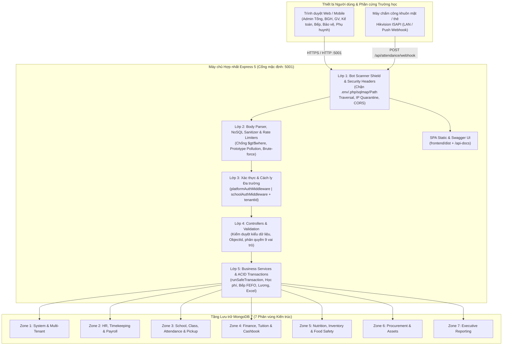
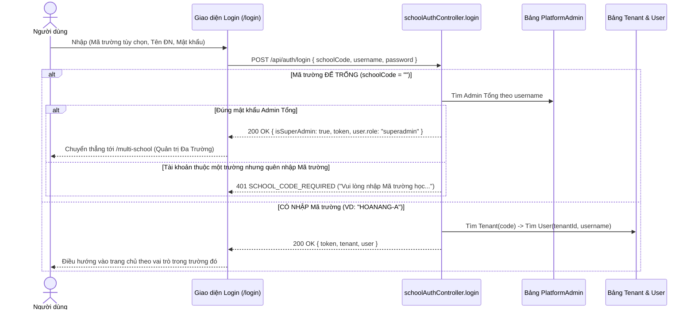
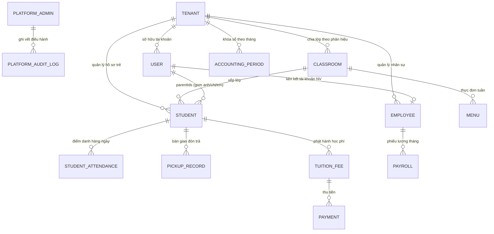

# TÀI LIỆU PHÂN TÍCH & THIẾT KẾ HỆ THỐNG
## Nền tảng Quản lý Trường Mầm non Đa Trường & Đa Phân hiệu (`Hoa Nắng SaaS`)

> **Phiên bản kiến trúc:** `2.1 — Unified Full-Stack Multi-Tenant SaaS`  
> **Cổng dịch vụ hợp nhất mặc định:** `5001` (`Express 5` + `React 19 SPA` + `Swagger OpenAPI 3.0.3`)  
> **Hệ quản trị CSDL:** `MongoDB 7.0+` (Replica Set hỗ trợ giao dịch đa bảng ACID Transaction)

---

## 1. Tổng quan Bài toán & Mô hình Nghiệp vụ Thực tế

### 1.1. Đặc thù vận hành của Chuỗi Trường Mầm non ngoài thực tế
Khác với trường phổ thông, hệ thống giáo dục mầm non tư thục / công lập nhiều cơ sở có 5 đặc thù cốt lõi mà phần mềm bắt buộc phải phản ánh đúng:
1. **Mô hình Quản trị 2 tầng (Đa Trường → Đa Phân hiệu)**:
   - Một chủ đầu tư hoặc tổng hội đồng quản trị điều hành **nhiều Trường độc lập (`Tenant`)**. Mỗi trường có Mã trường (`School Code`, ví dụ `HOANANG-A`, `HOANANG-B`) và **tài khoản Admin riêng của trường đó**.
   - Bên trong mỗi trường lại có thể chia thành nhiều **Phân hiệu / Cơ sở (`Campuses`)** như *Cơ sở chính*, *Phân hiệu 1*, *Phân hiệu 2* đặt tại các địa chỉ khác nhau, mỗi phân hiệu gắn với các lớp học riêng.
   - Khi khởi tạo hệ thống mới tinh trên máy chủ, chỉ có duy nhất **Tài khoản Admin Tổng (`admin`)** được tự động tạo ra; chính Admin Tổng sẽ chủ động khai báo từng trường thực tế và cấp tài khoản quản trị riêng cho từng trường.
2. **Độ tuổi nhận trẻ rộng (từ 6 tháng tuổi đến 6 tuổi)**:
   - Bao gồm khối **Nhà trẻ (Dưới 3 tuổi)**: `6–12 tháng` (`6-12m`), `1–2 tuổi` (`1-2`), `2–3 tuổi` (`2-3`) và khối **Mẫu giáo (3–6 tuổi)**: Mẫu giáo bé (`3-4`), Mẫu giáo nhỡ (`4-5`), Mẫu giáo lớn (`5-6`).
3. **An toàn tính mạng, Y tế, Dinh dưỡng & Đón trả trẻ là ưu tiên số 1**:
   - Hồ sơ trẻ bắt buộc theo dõi **Dị ứng thực phẩm**, **Bệnh lý nền**, **Nhóm máu**, **Mã thẻ BHYT**, **Lịch sử tiêm chủng**, **Cân nặng – Chiều cao hàng tháng** và tối thiểu **2 Phụ huynh liên hệ khẩn cấp**.
   - Thực đơn bếp ăn phải đối chiếu tự động với danh sách dị ứng của học sinh trong lớp trước khi cho phép phê duyệt/nấu; thức ăn mỗi bữa phải **lưu mẫu 24 giờ ở 2–8°C** (và cho phép niêm phong gửi kiểm nghiệm ngay nếu nghi ngờ sự cố ATTP).
   - Quy trình trả trẻ buổi chiều hỗ trợ song song **Trả trẻ 1 chạm tại lớp** (cho Giáo viên chủ nhiệm), **Quét mã QR / OTP tại cổng** (cho Bảo vệ), chặn trả nhầm trẻ đang vắng mặt và hỗ trợ **Hoàn tác trả trẻ nhầm** trong ngày kèm thông báo đính chính tức thời cho Phụ huynh.
4. **Học phí gắn liền với Tiền ăn bán trú & Ngày nghỉ có phép**:
   - Khi phát hành hóa đơn tháng mới, hệ thống tự động thống kê số ngày trẻ **nghỉ có phép (`absent_permission`)** của tháng liền trước (nếu tháng trước có thu tiền ăn) để khấu trừ tiền ăn minh bạch, đồng thời cho phép Kế toán xem trước và tinh chỉnh từng trường hợp đặc biệt trước khi chốt phát hành.
5. **Đơn giản hóa tối đa cho Giáo viên & Phụ huynh**:
   - **1 màn hình Đăng nhập duy nhất**: Để trống *Mã trường* là vào Admin Tổng; nhập *Mã trường* là vào đúng trường tương ứng.
   - Khi nhà trường thêm học sinh hoặc nhập file Excel, hệ thống **tự động tạo tài khoản Phụ huynh** bằng chính Số điện thoại của Bố/Mẹ (mật khẩu lần đầu `123456`) và tự động gom các bé anh/chị/em ruột về chung một tài khoản Phụ huynh.

---

## 2. Kiến trúc Tổng thể Hệ thống (System Architecture)

### 2.1. Sơ đồ Kiến trúc Hợp nhất (Unified Full-Stack Architecture)



### 2.2. Nguyên tắc Phân tầng Trách nhiệm
- **`routes/` & `saas/routes/`**: Chỉ định nghĩa đường dẫn HTTP, gắn Rate-Limiter, Middleware xác thực (`platformAuthMiddleware`, `schoolAuthMiddleware`, `saasDeviceAuth`), kiểm tra vai trò (`roleCheck`) và kiểm tra kỳ kế toán mở (`accountingPeriodOpen`). Tuyệt đối không chứa truy vấn DB.
- **`middlewares/`**: Chịu trách nhiệm bảo mật vành đai (`botScannerShield`, `securityAndErrorMiddleware`), xác thực JWT, trích xuất và khóa cứng `req.tenantId` từ Token (bỏ qua mọi `tenantId` giả mạo từ client).
- **`controllers/`**: Kiểm tra định dạng đầu vào (`isValidObjectId`, ngày lịch thực tế, số nguyên VND, giới hạn phân trang), gọi tầng `services` và trả JSON tiếng Việt thống nhất.
- **`services/`**: Thực thi nghiệp vụ cốt lõi (tính công tự động, tính lương, khấu trừ tiền ăn, xuất/nhập kho FEFO, nhập/xuất Excel chống Zip-Bomb & Formula Injection, điều phối giao dịch nguyên tử `runSafeTransaction`).
- **`models/zone1..zone7`**: Định nghĩa cấu trúc dữ liệu Mongoose chia rõ theo 7 miền nghiệp vụ cùng hệ thống chỉ mục đa trường `{ tenantId: 1, ... }`.

---

## 3. Mô hình Phân quyền 9 Vai trò & Luồng Đăng nhập Hợp nhất

### 3.1. Luồng Đăng nhập 1 Màn hình (`POST /api/auth/login`)



### 3.2. Ma trận Trách nhiệm 9 Vai trò

| Vai trò (`role`) | Phạm vi | Chức năng chính trên hệ thống |
| :--- | :--- | :--- |
| **`superadmin`** *(Admin Tổng)* | Toàn chuỗi trường | Xem KPI toàn chuỗi, tạo trường mới kèm tài khoản Admin riêng, cấu hình/đặt lại mật khẩu Admin trường, bấm *"Vào quản lý trường"* để điều hành trực tiếp từng trường, đổi mật khẩu Admin Tổng. |
| **`admin`** *(Quản trị Trường)* | Trong 1 trường (`tenantId`) | Toàn quyền cấu hình Phân hiệu, Lớp học, Học sinh, Tài khoản nội bộ & Phụ huynh, Nhân sự, Tài chính – Học phí – Hoàn phí, Bếp ăn, Mua sắm – Tài sản, Khóa/mở kỳ kế toán. |
| **`principal`** *(Hiệu trưởng)* | Trong 1 trường | Bảng điều hành tổng quan Hiệu trưởng, quản lý Lớp & Phân hiệu, duyệt Đơn xin nghỉ học, duyệt Thực đơn tuần, duyệt Đề xuất mua sắm / Chi vận hành / Hoàn học phí, xác nhận Bảng lương, xem Báo cáo. |
| **`teacher`** *(Giáo viên)* | Các lớp được phân công | Điểm danh đến/về, Trả trẻ 1 chạm tại lớp (hoặc nhập người đón đột xuất có lưu SĐT), Hoàn tác trả nhầm, ghi Nhật ký chăm sóc (ăn/ngủ/vệ sinh), thêm/cập nhật Học sinh & Sức khỏe lớp mình, trao đổi với Phụ huynh. |
| **`accountant`** *(Kế toán)* | Trong 1 trường | Thiết lập biểu phí, phát hành Hóa đơn học phí (có xem trước khấu trừ tiền ăn tháng trước), thu tiền & in phiếu thu, Đề nghị/Chi hoàn phí, Chi vận hành, Chi đơn mua sắm, Sổ quỹ tiền mặt, Tính/điều chỉnh Bảng lương, Xuất/Nhập Excel tài chính. |
| **`hr`** *(Nhân sự)* | Trong 1 trường | Quản lý Phòng ban, Hồ sơ Nhân sự (tạo 1 bước kèm tài khoản đăng nhập), Phân ca & Phân công đứng lớp, Máy chấm công ISAPI & Ánh xạ mã sinh trắc học, Duyệt đơn nghỉ phép nhân sự, Lập bảng lương tháng. |
| **`chef`** *(Bếp trưởng)* | Trong 1 trường | Bảng điều hành Bếp (tự động tổng hợp sĩ số có mặt & cảnh báo trẻ dị ứng theo lớp), xây dựng Thực đơn tuần hiện tại/tuần tới, Quản lý Món ăn, Nhập/Xuất kho thực phẩm FEFO, Kiểm thực 3 bước & Lưu mẫu 24h, Thiết bị bếp. |
| **`guard`** *(Bảo vệ)* | Trong 1 trường | Trực cổng trường: Quét mã QR / OTP xác nhận người đón trẻ, ghi nhận Khách ra vào, kiểm nhận Xe giao thực phẩm/vật tư, báo cáo Sự cố an ninh, Bàn giao ca trực, Bật cảnh báo khẩn cấp. |
| **`parent`** *(Phụ huynh)* | Chỉ các con ruột đã liên kết | Xem trạng thái điểm danh đến/về & người đón theo thời gian thực, xem Thực đơn & Nhật ký ăn ngủ hàng ngày, gửi Đơn xin nghỉ học, đăng ký Người đón & tạo mã QR đón trẻ, xem Hóa đơn học phí, nhắn tin Giáo viên, gửi Góp ý BGH, đổi mật khẩu. |

---

## 4. Thiết kế Cơ sở Dữ liệu 7 Phân vùng (`74+ Collections`)

Toàn bộ mô hình dữ liệu tại `backend/src/models/` được phân chia nghiêm ngặt thành **7 Phân vùng (Zones)** để tách biệt miền nghiệp vụ và kiểm soát quyền truy cập:

| Phân vùng | Thư mục Model | Các thực thể (Collections) tiêu biểu |
| :--- | :--- | :--- |
| **Zone 1 — Hệ thống & Đa trường** | `models/zone1_system/` | `PlatformAdmin`, `PlatformAuditLog`, `Tenant` *(chứa mảng `campuses`)*, `User`, `Permission`, `RevokedSession`, `MfaChallenge`, `Notification`, `Conversation`, `ChatMessage`, `AuditLog`, `ImportIdempotency`, `PrincipalTask` |
| **Zone 2 — Nhân sự, Chấm công & Lương** | `models/zone2_hr/` | `Department`, `Employee`, `StaffShift`, `StaffReplacement`, `TimekeepingDevice`, `AttendanceDevicePersonMapping`, `RawAttendanceEvent`, `TimekeepingWebhookLog`, `AttendanceRecord`, `TimekeepingCorrectionRequest`, `LeaveRequest`, `Payroll`, `PayrollEvent`, `InternalAnnouncement`, `HrAccessLog` |
| **Zone 3 — Học sinh, Lớp, Điểm danh & Cổng** | `models/zone3_school/` | `Classroom`, `Student` *(chứa `allergies`, `vaccinations`, `growthRecords`, `authorizedPickers`)*, `StudentCodeCounter`, `StudentTransferHistory`, `StudentProfileChangeRequest`, `StudentAttendance`, `StudentLeaveRequest`, `ClassroomDailyCareReport`, `ClassroomAnnouncement`, `PickupRecord`, `PickupOtpChallenge`, `StudentGateEvent`, `SchoolVisitor`, `SupplierDelivery`, `SecurityIncident`, `GuardShiftHandover`, `GuardEmergencyMode`, `ParentFeedback` |
| **Zone 4 — Tài chính, Học phí & Kế toán** | `models/zone4_finance/` | `FeeSchedule`, `TuitionFee`, `Payment`, `InvoiceAdjustment`, `TuitionRefundRequest`, `OperatingExpenseRequest`, `OperatingExpense`, `PurchaseExpense`, `DailyCashReconciliation`, `AccountingPeriod` |
| **Zone 5 — Bếp ăn, Kho & VSATTP** | `models/zone5_nutrition/` | `Dish`, `Menu`, `IngredientMaster`, `Supplier`, `Inventory`, `InventoryTransaction`, `InventoryReconciliation`, `MealServing`, `FoodInspection`, `FoodSample`, `KitchenEquipment`, `KitchenStaff`, `KitchenRequest`, `KitchenDayClosing` |
| **Zone 6 — Mua sắm & Tài sản** | `models/zone6_procurement/` | `ItemMaster`, `ProcurementRequest`, `PurchaseOrder`, `Asset` |
| **Zone 7 — Báo cáo Điều hành** | `models/zone7_reporting/` | `Report` |

### Sơ đồ Quan hệ Thực thể Cốt lõi (Core ERD)



### Quy tắc Compound Multi-Tenant Unique Index
Dịch vụ [multiTenantIndexService.js](../backend/src/services/multiTenantIndexService.js) tự động đồng bộ khi máy chủ khởi động để đảm bảo hai trường học độc lập (`Tenant A` và `Tenant B`) có thể dùng trùng mã lớp, mã học sinh (`HS001`), mã nhân viên (`GV001`), số phiếu thu, kỳ kế toán (`2026-11`), ngày đối soát sổ quỹ mà **không bao giờ đụng độ nhau**, trong khi vẫn chặn trùng lặp tuyệt đối bên trong từng trường:
- `{ tenantId: 1, studentCode: 1 }`, `{ tenantId: 1, employeeCode: 1 }`, `{ tenantId: 1, username: 1 }`
- `{ tenantId: 1, month: 1 }` (`accountingperiods`), `{ tenantId: 1, workDate: 1 }` (`dailycashreconciliations`)
- `{ tenantId: 1, receiptNumber: 1 }` (`payments`), `{ tenantId: 1, documentNumber: 1 }` (`operatingexpenses`)

---

## 5. Thiết kế Bảo mật Đa lớp & Chống Bot Quét khi Đẩy lên Mạng Public

Khi triển khai hệ thống ra tên miền Internet công khai, máy chủ sẽ liên tục bị các mạng bot tự động (Shodan, Nuclei, WPScan, SQLMap, Credential-Stuffing Bots) dò quét. Hệ thống áp dụng **6 lớp phòng thủ chủ động**:

1. **Chặn sớm Đường dẫn Dò quét & Chống "Soft-200" (`botScannerShield.js`)**:
   - Mọi truy cập vào dotfiles nhạy cảm (`/.env`, `/.git`, `/.aws`, `/.ssh`, `/docker-compose.yml`), đường dẫn CMS/PHP/Admin (`*.php`, `*.asp`, `/wp-admin`, `/phpmyadmin`, `/actuator`, `/cgi-bin`, `/vendor/phpunit`) hoặc Path Traversal (`..`, `%2e%2e`, `%00`) đều bị chặn ngay ở đầu chuỗi Express với mã `404`/`400` siêu nhẹ, **không bao giờ rơi xuống SPA Fallback trả `index.html` (`200 OK`)** khiến công cụ quét hiểu nhầm mục tiêu tồn tại.
2. **Nhận diện Công cụ Quét & Tự động Cách ly IP (`IP Strike Quarantine`)**:
   - Chặn ngay `403` các User-Agent công cụ tấn công (`sqlmap`, `nikto`, `nmap`, `masscan`, `nuclei`, `gobuster`, `ffuf`, `acunetix`...).
   - Bộ theo dõi IP giới hạn cứng tối đa `5,000` IP trong RAM (chống tràn bộ nhớ khi DDoS): nếu 1 IP ngoại mạng chạm bẫy dò quét `>= 8` lần trong `5 phút`, hệ thống tự động cách ly IP đó trong `15 phút` (`429 SCANNER_QUARANTINED`) trước khi phân tích JSON hay truy vấn MongoDB.
3. **Chống Lập chỉ mục Tìm kiếm (`robots.txt` & `X-Robots-Tag`)**:
   - Phục vụ `/robots.txt` (`Disallow: /`) và gắn header `X-Robots-Tag: noindex, nofollow, noarchive` trên toàn bộ phản hồi để không lộ trang nội bộ trường học lên công cụ tìm kiếm.
4. **Làm sạch NoSQL Injection & Prototype Pollution (`requestPayloadSanitizer`)**:
   - Quét đệ quy mọi gói tin `req.body`, `req.query`, `req.params` (giới hạn độ sâu `<= 14` tầng chống JSON-Bomb) để loại bỏ triệt để các toán tử MongoDB trái phép bắt đầu bằng `$` (`$gt`, `$ne`, `$where`, `$regex`) và khóa `__proto__`, `constructor`, `prototype`.
5. **Bẫy Bot Ẩn (`Honeypot`) & Giới hạn Tần suất (`Rate-Limiting`)**:
   - Biểu mẫu Đăng nhập tích hợp trường bẫy ẩn `_hp_website` (người dùng thật không nhìn thấy; bot tự điền sẽ bị chặn `403` ngay mà không tốn CPU băm `bcrypt`).
   - Áp dụng `authLimiter` (tối đa 20 lần/15 phút/IP trên cả `/api/auth/login` và `/api/multi-school/login`), `mfaVerifyLimiter` (5 lần/15 phút), `deviceIngestLimiter` (180 sự kiện/phút) và `apiGeneralLimiter` (500 yêu cầu/phút).
6. **An toàn Tập tin Tải lên (Magic-Bytes & Anti-Zip-Bomb)**:
   - Tệp minh chứng kiểm tra chữ ký nhị phân (Magic Bytes) chỉ chấp nhận `PDF / PNG / JPEG / WEBP` và chặn Symlink / Path Traversal.
   - Tệp Excel nhập học sinh và tài chính kiểm tra cấu trúc Central Directory ZIP, giới hạn tổng dung lượng giải nén (`<= 25 MB` chống Zip-Bomb tràn RAM) và tự động tiền tố hóa các chuỗi bắt đầu bằng `=`, `+`, `-`, `@` chống CSV/Excel Formula Injection.

---

## 6. Quy chuẩn Tổ chức Thư mục & Cách đặt tên File

Dự án tuân thủ quy tắc đặt tên nhất quán giúp lập trình viên kế thừa tra cứu nhanh ngay từ tên file:

```text
school-management-api/
├── README.md                              # Tổng quan dự án & Hướng dẫn chạy nhanh (cổng 5001)
├── AGENTS.md                              # Quy chuẩn kiến trúc, hiệu năng & Clean Code bắt buộc
├── DOCKER.md                              # Hướng dẫn vận hành Docker & Sao lưu/Khôi phục DB
├── Dockerfile & docker-compose.yml        # Đóng gói Unified Full-Stack (1 image chạy cả FE + BE)
├── docs/
│   ├── PHAN_TICH_THIET_KE_HE_THONG.md     # Tài liệu Phân tích & Thiết kế Hệ thống (tài liệu này)
│   └── archive/                           # Lưu trữ lịch sử các bản ghi chú nâng cấp theo giai đoạn
├── backend/
│   ├── server.js                          # Entrypoint khởi chạy máy chủ (0.0.0.0:5001) & Graceful Shutdown
│   ├── app.js                             # Ứng dụng chế độ đơn trường (Legacy compatibility)
│   ├── docs/SWAGGER_DATABASE_GUIDE.md     # Hướng dẫn sử dụng Swagger UI & Từ điển Database
│   ├── src/
│   │   ├── config/                        # camelCase: database.js, loadEnv.js
│   │   ├── docs/                          # Đặc tả tự động OpenAPI 3.0.3 & Mongoose Schema Introspector
│   │   ├── middlewares/                   # camelCase: botScannerShield.js, securityAndErrorMiddleware.js...
│   │   ├── controllers/                   # <domain>Controller.js (camelCase)
│   │   ├── services/                      # <domain>Service.js (camelCase, chứa logic cốt lõi & Transaction)
│   │   ├── models/zone1..zone7/           # <EntityName>.js (PascalCase khớp tên Model Mongoose)
│   │   ├── routes/                        # <domain>Routes.js (Legacy routes)
│   │   ├── saas/                          # Kiến trúc Đa Trường: assembleSaasApp.js, controllers/, middlewares/, routes/
│   │   ├── scripts/                       # Kịch bản vận hành: dockerBootstrapDb.js, seedDemoFull.js...
│   │   └── utils/                         # Hàm thuần túy dùng chung: safeTransaction.js, dateHelpers.js...
│   └── tests/                             # Bộ kiểm thử tự động Jest + Supertest + MongoMemoryReplSet
└── frontend/
    └── src/
        ├── App.jsx                        # Định tuyến trung tâm & Phân quyền Route theo 9 vai trò
        ├── api/                           # <domain>.js (camelCase) — Tập trung lời gọi HTTP qua axiosConfig.js
        ├── pages/                         # <PageName>.jsx (PascalCase) — Chỉ chứa các màn hình cấp Route
        ├── components/                    # <ComponentName>.jsx / <Domain>Panel.jsx (PascalCase) — Thành phần tái sử dụng & Sub-panels
        ├── utils/                         # camelCase: storage.js, dateHelpers.js...
        └── styles/ & index.css            # Hệ thống giao diện & Bảng màu phân nhóm chức năng Sidebar
```

### Quy tắc Đặt tên Bắt buộc:
1. **Backend**:
   - **Models (`models/zone*/`)**: `PascalCase.js` trùng khớp tên Model Mongoose (`Student.js`, `TuitionFee.js`, `PlatformAdmin.js`).
   - **Controllers / Services / Routes / Middlewares / Utils**: `camelCase.js` mang hậu tố đúng vai trò tầng (`*Controller.js`, `*Service.js`, `*Routes.js`, `*Middleware.js`).
2. **Frontend**:
   - **`pages/`**: Chỉ đặt các Component cấp màn hình gắn trực tiếp vào `<Route>` trong `App.jsx` (`PascalCase.jsx`, không dùng hậu tố `Page` dư thừa — ví dụ `StudentList.jsx`, `MultiSchoolManagement.jsx`, `StaffLeaveRequests.jsx`).
   - **`components/`**: Đặt các thành phần dùng chung (`AppShell.jsx`, `ErrorBoundary.jsx`, `QrScanner.jsx`, `QrCodeImage.jsx`) và các bảng con nhúng trong tab mang hậu tố `*Panel.jsx` / `*Modal.jsx` (`FeeSchedulePanel.jsx`, `ParentAccountPanel.jsx`, `KioskAttendancePanel.jsx`, `StudentExcelImportModal.jsx`).
   - **`api/` & `utils/`**: `camelCase.js` theo miền nghiệp vụ (`students.js`, `finance.js`, `multiSchool.js`, `storage.js`).

