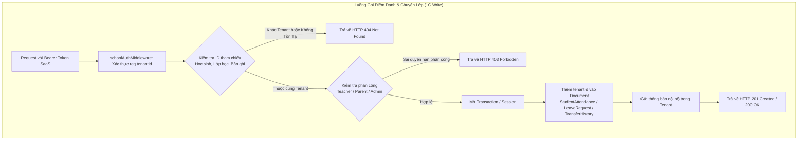
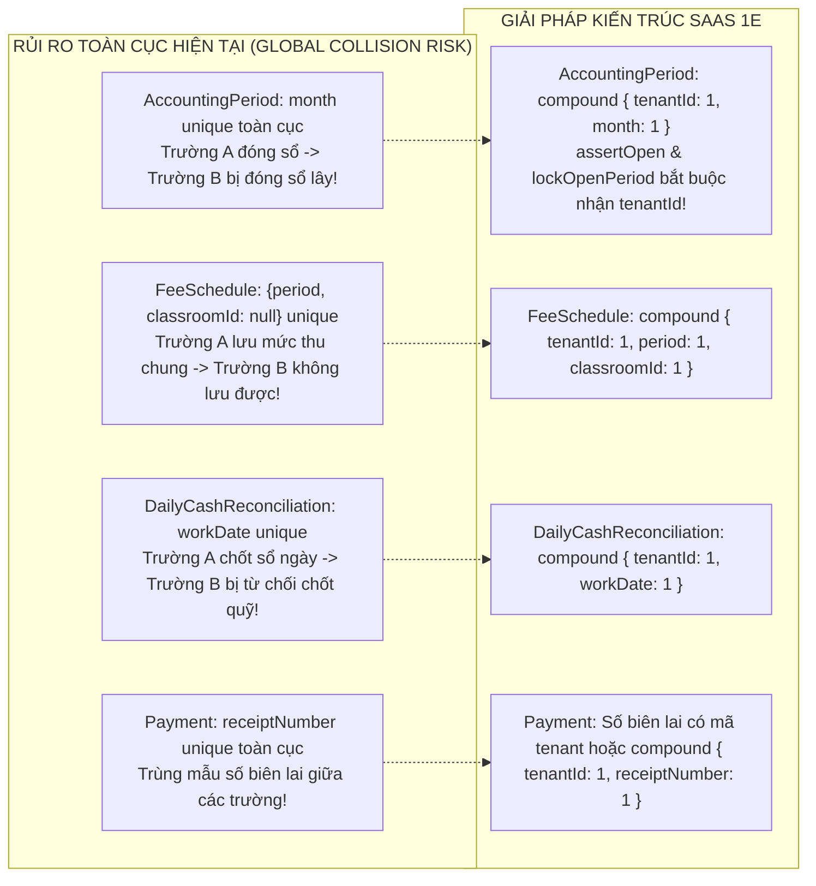

# Kế hoạch kỹ thuật SaaS 1C, 1D, 1E: Điểm danh, Nhân sự và Tài chính cốt lõi

**Vị trí tài liệu:** `docs/SAAS-PHASE-1C-1E-PLAN.md`  
**Dự án:** `school-management-api` (`E:\school-management-api`)  
**Trạng thái:** 1C.1–1C.5 đã hoàn thành và qua review cuối PASS ngày 02/11/2026; 1D và 1E chưa triển khai. Dừng tại 1C theo yêu cầu người dùng.  
**Nguyên tắc thực thi:**
- Tiếp nối giai đoạn SaaS 1A (Nền tảng Control Plane) và 1B (Cách ly luồng đọc Học sinh & Lớp học) đã nghiệm thu; **không mở lại 1B**.
- Giữ nguyên toàn bộ uncommitted changes hiện tại (`git status`).
- Không tác động database thật, không chạy migration, không commit/push/reset/stash/clean.
- Mọi kiểm thử tự động của từng giai đoạn được thực hiện trên môi trường bộ nhớ ảo cô lập (`MongoMemoryReplSet`).
- Chỉ mở router SaaS khi toàn bộ endpoint trong phạm vi đã hoàn thành scoping, kiểm thử và vượt qua review độc lập (Fail-closed 501 cho mọi endpoint chưa duyệt).

---

## 1. Tổng quan lộ trình SaaS 1C, 1D, 1E

| Giai đoạn | Trọng tâm nghiệp vụ | Phân hệ / Domain chính | Trạng thái SaaS Router hiện tại |
| :--- | :--- | :--- | :--- |
| **SaaS 1C** | Cách ly Điểm danh học sinh & Chuyển lớp | `StudentAttendance`, `StudentLeaveRequest`, `StudentTransferHistory`, `transferStudentClassroom` | Đang đóng qua `tenantFeatureGate` (HTTP 501) |
| **SaaS 1D** | Cách ly Nhân sự & Tổ chức | `Department`, `Employee`, `User` (Internal Accounts), `StaffShift`, `StaffReplacement`, `LeaveRequest` (Nhân sự), `Timekeeping` cốt lõi | Đang đóng qua `tenantFeatureGate` (HTTP 501) |
| **SaaS 1E** | Cách ly Tài chính cốt lõi | `FeeSchedule`, `TuitionFee` (Hóa đơn), `Payment` (Biên lai), `AccountingPeriod`, `DailyCashReconciliation`, `InvoiceAdjustment`, `TuitionRefundRequest`, `OperatingExpense`, `PurchaseExpense` | Đang đóng qua `tenantFeatureGate` (HTTP 501) |

---

## 2. Giai đoạn SaaS 1C: Cách ly Điểm danh học sinh và Chuyển lớp

### 2.1. Danh mục Endpoint và Phân quyền

| Phương thức | Đường dẫn Endpoint | Controller Handler | Quyền hạn (Roles) | Mục tiêu cách ly SaaS |
| :--- | :--- | :--- | :--- | :--- |
| `POST` | `/api/v1/attendance` | `createAttendance` | `teacher`, `admin` | Điểm danh 1 học sinh; kiểm tra học sinh và lớp thuộc tenant; ghi `tenantId`. |
| `POST` | `/api/v1/attendance/bulk` | `createBulkAttendance` | `teacher`, `admin` | Điểm danh cả lớp; kiểm tra lớp và danh sách học sinh thuộc tenant; ghi `tenantId`. |
| `POST` | `/api/v1/attendance/check-in` | `automaticCheckIn` | `teacher`, `admin` | Điểm danh tự động qua thẻ/khuôn mặt; truy vấn mã thẻ chỉ trong tenant hiện tại. |
| `GET` | `/api/v1/attendance/student/:studentId` | `getAttendanceByStudent` | `parent`, `teacher`, `admin`, `principal` | Đọc lịch sử điểm danh học sinh; ID học sinh ngoại lai trả 404; phụ huynh chỉ xem con mình trong tenant. |
| `GET` | `/api/v1/attendance/class/:classroomId` | `getAttendanceByClass` | `teacher`, `admin`, `principal` | Đọc bảng điểm danh lớp theo ngày; lớp ngoại lai trả 404/rỗng; giáo viên chỉ xem lớp được phân công. |
| `PUT` | `/api/v1/attendance/:id` | `updateAttendance` | `admin`, `teacher` | Sửa bản ghi điểm danh; bản ghi ngoại lai trả 404; giáo viên chỉ sửa bản ghi thuộc lớp được phân công. |
| `DELETE` | `/api/v1/attendance/:id` | `deleteAttendance` | `admin` | Xóa bản ghi điểm danh; bản ghi ngoại lai trả 404. |
| `POST` | `/api/v1/attendance/leave-requests` | `createLeaveRequest` | `parent` | Phụ huynh gửi đơn xin nghỉ; mở khóa cổng SaaS (loại bỏ hardcoded gate 403); ghi `tenantId`. |
| `GET` | `/api/v1/attendance/leave-requests` | `getLeaveRequests` | `parent`, `teacher`, `admin`, `principal` | Danh sách đơn xin nghỉ có lọc `tenantId`; phụ huynh xem đơn của con; giáo viên xem lớp mình phụ trách. |
| `PATCH` | `/api/v1/attendance/leave-requests/:id/review` | `reviewLeaveRequest` | `admin`, `principal` | Duyệt/từ chối đơn nghỉ; tạo bản ghi `StudentAttendance` có `tenantId` khi duyệt. |
| `GET` | `/api/v1/attendance/reports/absence` | `getAbsenceReport` | `teacher`, `admin`, `principal` | Báo cáo vắng mặt định kỳ; tổng hợp dữ liệu hoàn toàn trong phạm vi `tenantId`. |
| `POST` | `/api/v1/students/:id/transfer` | `transferStudentClassroom` | `admin`, `hr`, `principal` | Ghi nhận chuyển lớp; học sinh, lớp nguồn, lớp đích đều phải thuộc cùng `tenantId`. |

### 2.2. Chi tiết Luồng đọc & Ghi (Read / Write Flows)



1. **Luồng Điểm danh tự động (`automaticCheckIn`)**:
   - Client gửi `{ identifier, method: 'card'|'face' }`.
   - Controller áp dụng `buildTenantFilter(req)` vào truy vấn `Student.findOne({ [field]: value, status: 'enrolled', ...tenantFilter })`.
   - Nếu không tìm thấy trong tenant -> HTTP 404 (ngăn chặn tình huống quẹt thẻ của học sinh trường A được ghi nhận tại đầu đọc trường B).
   - Bản ghi `StudentAttendance` tạo mới lưu kèm `tenantId: resolvedContext.tenantId`.
2. **Luồng Chuyển lớp học sinh (`transferStudentClassroom`)**:
   - Client gửi `POST /api/v1/students/:id/transfer` kèm body `{ toClassroomId, reason, effectiveDate }` và header `Idempotency-Key`.
   - Xác thực idempotency: `ImportIdempotency` cần được kiểm tra cùng `tenantId` (hoặc tiền tố tenant) để tránh xung đột khóa ngẫu nhiên giữa hai trường độc lập.
   - Bên trong `runStudentTransaction(session)`:
     - Đọc học sinh: `Student.findOne({ _id: id, ...tenantFilter }).session(session)` -> 404 nếu ngoại lai.
     - Đọc lớp nguồn: `Classroom.findOne({ _id: student.classroomId, ...tenantFilter }).session(session)` -> 404 nếu ngoại lai.
     - Đọc lớp đích: `Classroom.findOne({ _id: toClassroomId, status: 'active', ...tenantFilter }).session(session)` -> 404 nếu ngoại lai (ngăn chuyển học sinh xuyên trường).
     - Kiểm tra cùng năm học (`schoolYear`).
     - Tăng sĩ số lớp đích và giảm sĩ số lớp nguồn nguyên tử (`findOneAndUpdate` có kèm `tenantFilter`).
     - Cập nhật lớp trên hồ sơ học sinh có điều kiện kiểm tra phiên bản concurrency.
     - Tạo bản ghi `StudentTransferHistory` với `tenantId`.

### 2.3. Rủi ro Phụ thuộc, Chỉ mục & Dữ liệu (Dependency / Index / Migration Risks)

1. **Rủi ro Chỉ mục Toàn cục trên `ImportIdempotency`**:
   - `ImportIdempotencySchema` hiện có `idempotencyKey: { type: String, unique: true }`.
   - Nếu Trường A và Trường B vô tình dùng cùng một UUID hoặc chuỗi khóa giống nhau, Trường B sẽ bị từ chối 409 hoặc replayed kết quả của Trường A.
   - *Giải pháp 1C*: Bổ sung `tenantId` vào `ImportIdempotency` và chuyển sang compound unique index `{ tenantId: 1, idempotencyKey: 1 }`, hoặc tiền tố hóa khóa theo format `${tenantId}:${idempotencyKey}` trong service layer.
2. **Chỉ mục trên `StudentAttendance`**:
   - Hiện tại có unique partial index: `{ studentId: 1, attendanceDateKey: 1 }`. Vì `studentId` là `ObjectId` duy nhất, không gây xung đột dữ liệu chéo tenant.
   - Cần bổ sung các compound index hiệu năng: `{ tenantId: 1, studentId: 1, attendDate: 1 }`, `{ tenantId: 1, classroomId: 1, attendDate: 1 }`, `{ tenantId: 1, attendDate: 1 }`.
3. **Mở khóa Hardcoded Gate trong `createLeaveRequest`**:
   - Hiện tại dòng 503 trong `attendanceController.js` chứa:
     ```js
     const tenantContext = resolveTenantContext(req);
     if (tenantContext.isSaaS) {
         return res.status(403).json({ success: false, message: 'Thao tác gửi đơn nghỉ chưa mở cho trường học SaaS' });
     }
     ```
   - Trong giai đoạn 1C, đoạn kiểm tra này sẽ được chuyển thành logic lưu `tenantId: tenantContext.tenantId`.

### 2.4. Phân chia Task nhỏ và Tiêu chí nghiệm thu SaaS 1C

#### Task 1C.1 — Nền dữ liệu & Index Điểm danh / Chuyển lớp
- **Mô tả**: Bổ sung `tenantId` (optional, default `null`) vào `StudentAttendance`, `StudentLeaveRequest`, `ImportIdempotency`. Cấu hình compound indexes phục vụ truy vấn theo trường.
- **Acceptance Criteria**:
  - Bản ghi tạo bởi trường SaaS bắt buộc có `tenantId: ObjectId`.
  - Bản ghi tạo bởi Legacy lưu `tenantId: null` hoặc không có trường này.
  - Các index unique mới không chặn bản ghi `null` của Legacy.
- **Test Suite**: `backend/tests/saas/phase1c1_data_boundary.test.js`.

#### Task 1C.2 — Quy tắc Quyền Điểm danh & Đơn xin nghỉ
- **Mô tả**: Tích hợp `buildTenantFilter` vào toàn bộ 11 handler của `attendanceController.js`.
- **Acceptance Criteria**:
  - ID học sinh / lớp học / đơn xin nghỉ thuộc trường khác trả về HTTP 404.
  - Phụ huynh trường A không thể gửi đơn nghỉ hoặc xem điểm danh của học sinh trường B.
  - Check-in qua thẻ/khuôn mặt chỉ nhận diện học sinh trong đúng trường học đó.
  - Mở khóa thành công đơn xin nghỉ SaaS (`POST /leave-requests`).
- **Test Suite**: `backend/tests/saas/phase1c2_attendance_scoping.test.js`.

#### Task 1C.3 — Luồng Chuyển lớp An toàn Đa trường
- **Mô tả**: Áp dụng tenant scoping và bảo vệ khóa idempotency trong `transferStudentClassroom` (`studentController.js`).
- **Acceptance Criteria**:
  - Không thể chuyển học sinh từ Trường A sang lớp học của Trường B (trả về 404).
  - Không thể dùng tài khoản quản trị Trường B để thực hiện lệnh chuyển lớp cho học sinh Trường A.
  - Sĩ số lớp nguồn và lớp đích của đúng trường được cập nhật nguyên tử.
  - `StudentTransferHistory` lưu đúng `tenantId`.
- **Test Suite**: `backend/tests/saas/phase1c3_transfer_scoping.test.js`.

#### Task 1C.4 — SaaS Routing & Unlocking Module Attendance
- **Mô tả**: Tạo `backend/src/saas/routes/schoolAttendanceRoutes.js`, mount tại `/api/v1/attendance` và `/api/attendance` trong `createSaasApp.js`. Mở endpoint `POST /api/v1/students/:id/transfer` trong `schoolStudentRoutes.js`.
- **Acceptance Criteria**:
  - Các route điểm danh được bảo vệ bởi `schoolAuthMiddleware` và `roleCheck`.
  - Parameter shadowing được bảo vệ qua `reservedRoutes.js`.
  - Các phương thức/sub-route chưa duyệt tiếp tục bị gate 501.
- **Test Suite**: `backend/tests/saas/phase1c4_router.test.js`.

#### Task 1C.5 — Nghiệm thu Tích hợp End-to-End SaaS 1C
- **Mô tả**: Kịch bản tích hợp đa trường (Tenant A, Tenant B, Legacy) chạy Supertest toàn bộ luồng điểm danh hàng ngày, xin nghỉ có phép và chuyển lớp đồng thời.
- **Acceptance Criteria**: 100% test pass, exit code 0, không can thiệp DB thật.
- **Test Suite**: `backend/tests/saas/phase1c5_integration_acceptance.test.js`.

---

## 3. Giai đoạn SaaS 1D: Cách ly Nhân sự và Tổ chức (HR & Personnel Isolation)

### 3.1. Danh mục Endpoint và Phân quyền

| Phương thức | Đường dẫn Endpoint | Controller Handler | Quyền hạn (Roles) | Mục tiêu cách ly SaaS |
| :--- | :--- | :--- | :--- | :--- |
| `GET` | `/api/v1/hr/departments` | `getDepartments` | `admin`, `principal`, `accountant`, `hr` | Danh sách phòng ban; chỉ trả phòng ban thuộc `tenantId`. |
| `POST` | `/api/v1/hr/departments` | `createDepartment` | `admin` | Tạo phòng ban; mã phòng ban (`code`) chỉ unique trong cùng tenant. |
| `PUT` | `/api/v1/hr/departments/:id` | `updateDepartment` | `admin` | Cập nhật phòng ban; ID ngoại lai trả 404. |
| `GET` | `/api/v1/hr/employees` | `getEmployees` | `admin`, `principal`, `accountant`, `hr` | Danh sách nhân sự; phân trang và tìm kiếm theo tenant. |
| `GET` | `/api/v1/hr/employees/:id` | `getEmployeeById` | `admin`, `principal`, `accountant`, `hr` | Chi tiết nhân sự; ID ngoại lai trả 404. |
| `POST` | `/api/v1/hr/employees` | `createEmployee` | `admin`, `hr` | Tạo nhân viên; mã nhân viên (`employeeCode`) chỉ unique trong tenant; liên kết User cùng tenant. |
| `PUT` | `/api/v1/hr/employees/:id` | `updateEmployee` | `admin`, `hr` | Cập nhật thông tin nhân viên; ID ngoại lai trả 404. |
| `DELETE` | `/api/v1/hr/employees/:id` | `deleteEmployee` | `admin`, `hr` | Nghỉ việc / xóa nhân viên; ID ngoại lai trả 404. |
| `GET` | `/api/v1/system/accounts` | `listInternalAccounts` | `admin`, `hr` | Danh sách tài khoản nhân viên nội bộ (`User`); chỉ hiện tài khoản thuộc `tenantId`. |
| `POST` | `/api/v1/system/accounts` | `createInternalAccount` | `admin`, `hr` | Tạo tài khoản nhân viên; tự động gán `tenantId: req.tenantId`. |
| `PATCH` | `/api/v1/system/accounts/:id` | `updateInternalAccount` | `admin`, `hr` | Cập nhật tài khoản; ID ngoại lai trả 404. |
| `PATCH` | `/api/v1/system/accounts/:id/role` | `updateInternalAccountRole` | `admin`, `hr` | Đổi vai trò tài khoản; không cho phép đổi tài khoản trường khác. |
| `DELETE` | `/api/v1/system/accounts/:id` | `deactivateInternalAccount` | `admin`, `hr` | Khóa tài khoản; ID ngoại lai trả 404. |
| `PUT` | `/api/v1/classrooms/:id/homeroom-teacher` | `assignHomeroomTeacher` | `admin`, `hr` | Phân công giáo viên chủ nhiệm; giáo viên và lớp học phải thuộc cùng tenant. |
| `GET` | `/api/v1/hr/staffing` | `getStaffing` | `admin`, `principal`, `hr` | Lịch phân công nhân sự các lớp học thuộc tenant. |
| `PUT` | `/api/v1/hr/staffing/classrooms/:id` | `assignClassroomStaff` | `admin`, `hr` | Phân công giáo viên/trợ giảng vào lớp thuộc tenant. |
| `POST` | `/api/v1/hr/staffing/shifts` | `createShift` | `admin`, `hr` | Tạo ca làm việc cho nhân viên trong tenant. |
| `POST` | `/api/v1/hr/staffing/replacements` | `createReplacement` | `admin`, `hr` | Tạo người dạy thay/làm thay; cả 2 nhân viên phải cùng tenant. |
| `POST` | `/api/v1/hr/leave-requests` | `createLeaveRequest` | Các vai trò nhân sự | Nhân viên gửi đơn nghỉ phép; ghi `tenantId`. |
| `GET` | `/api/v1/hr/leave-requests` | `getLeaveRequests` | `admin`, `principal`, `hr` | Danh sách đơn nghỉ phép nhân sự thuộc tenant. |
| `PATCH` | `/api/v1/hr/leave-requests/:id/review` | `processLeaveRequest` | `admin`, `principal` | Phê duyệt đơn nghỉ của nhân viên thuộc tenant. |
| `POST` | `/api/v1/timekeeping/check-in` | `manualCheckIn` | Các vai trò nhân sự | Chấm công trực tuyến của nhân viên thuộc tenant. |
| `GET` | `/api/v1/timekeeping/daily` | `getDailyTimekeeping` | `admin`, `principal`, `hr` | Bảng chấm công toàn trường theo ngày thuộc tenant. |

### 3.2. Luồng đọc & Ghi và Rủi ro Kiến trúc Nhân sự

1. **Rủi ro Chỉ mục Toàn cục trên `Department` và `Employee`**:
   - `Department.code: { unique: true }` là toàn cục. Các trường học đều có các phòng ban tiêu chuẩn như `BGH`, `GV`, `KT`, `NV`. Nếu để global unique, trường thứ hai tạo phòng ban `GV` sẽ bị lỗi duplicate key.
   - `Employee.employeeCode: { unique: true }` là toàn cục. Các trường học thường đánh mã nhân viên từ `GV001`, `NV001`.
   - *Giải pháp 1D*: Bổ sung `tenantId` vào `Department` và `Employee`. Trong môi trường MongoDB hỗ trợ, index được định nghĩa theo dạng compound `{ tenantId: 1, code: 1 }` và `{ tenantId: 1, employeeCode: 1 }`.
2. **Luồng Phân công Giáo viên Chủ nhiệm (`assignHomeroomTeacher`)**:
   - Client gửi `PUT /api/v1/classrooms/:id/homeroom-teacher` kèm `{ teacherId }`.
   - Controller kiểm tra:
     - Lớp học `_id: id` phải thuộc `req.tenantId` (404 nếu không khớp).
     - Giáo viên `_id: teacherId` phải là tài khoản `User` có `role: 'teacher'` và `tenantId: req.tenantId` (404 nếu ngoại lai).
     - Không cho phép gán giáo viên của Trường A làm chủ nhiệm lớp học của Trường B.
3. **Tuyển dụng đã ngừng hoạt động (Retired Recruitment)**:
   - Các route `/api/v1/hr/recruitment/*` giữ nguyên trạng thái HTTP 410 Gone theo quy định của nhà trường.

### 3.3. Phân chia Task nhỏ và Tiêu chí nghiệm thu SaaS 1D

- **Task 1D.1 — Nền dữ liệu Nhân sự & Phòng ban**: Thêm `tenantId` vào `Department`, `Employee`, `LeaveRequest`, `StaffShift`, `StaffReplacement`, `AttendanceRecord`, `MonthlyTimesheet`.
- **Task 1D.2 — Quản lý Tài khoản Nội bộ & Scoping User**: Áp dụng tenant scoping vào `systemUserController.js` (`/system/accounts`) và đồng bộ `Employee` - `User`.
- **Task 1D.3 — Scoping Nghiệp vụ Nhân sự & Phân công Lớp**: Áp dụng tenant scoping vào `hrController.js`, `staffingController.js`, và `assignHomeroomTeacher` trong `classroomController.js`.
- **Task 1D.4 — Scoping Chấm công Nhân sự Cốt lõi**: Cách ly luồng chấm công web (`manualCheckIn`, `dailyTimekeeping`, `adjustments`) theo `tenantId`.
- **Task 1D.5 — SaaS Router HR & Nghiệm thu Tích hợp**: Mount router SaaS nhân sự, xác minh cách ly đa trường 100% qua test tích hợp Supertest.

---

## 4. Giai đoạn SaaS 1E: Cách ly Tài chính cốt lõi (Core Finance Isolation)

### 4.1. Danh mục Endpoint và Phân quyền

| Phương thức | Đường dẫn Endpoint | Controller Handler | Quyền hạn (Roles) | Mục tiêu cách ly SaaS |
| :--- | :--- | :--- | :--- | :--- |
| `GET` | `/api/v1/finance/fee-schedules` | `getFeeSchedules` | `admin`, `principal`, `accountant` | Danh sách mức thu; chỉ tải mức thu theo kỳ của tenant. |
| `PUT` | `/api/v1/finance/fee-schedules` | `saveFeeSchedule` | `admin`, `accountant` | Lưu mức thu chuẩn theo lớp hoặc mặc định trường; ghi `tenantId`. |
| `DELETE` | `/api/v1/finance/fee-schedules/:id` | `deleteFeeSchedule` | `admin`, `accountant` | Xóa mức thu; ID ngoại lai trả 404. |
| `GET` | `/api/v1/finance/classrooms` | `getFinanceClassrooms` | `admin`, `principal`, `accountant` | Danh sách lớp chọn kỳ thu; chỉ hiện lớp thuộc tenant. |
| `POST` | `/api/v1/finance/tuition` | `createTuitionFee` | `admin`, `accountant` | Lập hóa đơn học phí lẻ; học sinh và lớp phải thuộc tenant; ghi `tenantId`. |
| `POST` | `/api/v1/finance/tuition/bulk` | `createBulkTuitionFees` | `admin`, `accountant` | Lập hóa đơn học phí hàng loạt cho lớp; kiểm tra lớp thuộc tenant. |
| `POST` | `/api/v1/finance/tuition/bulk/preview` | `previewBulkTuitionFees` | `admin`, `principal`, `accountant` | Xem trước danh sách hóa đơn theo mức thu của tenant. |
| `GET` | `/api/v1/finance/invoices` | `getInvoices` | `admin`, `principal`, `accountant` | Danh sách hóa đơn; phân trang và lọc hoàn toàn trong tenant. |
| `GET` | `/api/v1/finance/debts` | `getDebtReport` | `admin`, `principal`, `accountant` | Báo cáo công nợ học phí của tenant. |
| `POST` | `/api/v1/finance/debts/remind` | `sendDebtReminders` | `admin`, `accountant` | Gửi thông báo nhắc nợ phụ huynh; chỉ gửi cho phụ huynh trong tenant. |
| `GET` | `/api/v1/finance/tuition/student/:studentId` | `getTuitionByStudent` | `admin`, `principal`, `accountant`, `parent` | Lịch sử học phí học sinh; phụ huynh chỉ xem con mình; ngoại lai trả 404. |
| `PUT` | `/api/v1/finance/tuition/cancel/:id` | `cancelTuitionFee` | `admin` | Hủy hóa đơn học phí; ID ngoại lai trả 404. |
| `POST` | `/api/v1/finance/tuition/:id/adjustments` | `adjustTuitionFee` | `admin`, `accountant` | Miễn giảm / phụ thu / hoàn trả trên hóa đơn thuộc tenant. |
| `POST` | `/api/v1/finance/payment` | `makePayment` | `admin`, `accountant` | Thu học phí & lập biên lai; hóa đơn phải thuộc tenant; sinh số biên lai an toàn. |
| `GET` | `/api/v1/finance/payment/invoice/:invoiceId` | `getPaymentsByInvoice` | `admin`, `principal`, `accountant`, `parent` | Lịch sử thanh toán theo hóa đơn thuộc tenant. |
| `GET` | `/api/v1/finance/receipt/:paymentId` | `getReceipt` | `admin`, `principal`, `accountant`, `parent` | Đọc chi tiết phiếu thu / biên lai điện tử. |
| `GET` | `/api/v1/finance/accounting-period/:month` | `getPeriod` | `admin`, `principal`, `accountant` | Trạng thái kỳ kế toán (đóng/mở) của tenant hiện tại. |
| `POST` | `/api/v1/finance/accounting-period/:month/close` | `closePeriod` | `admin`, `principal` | Khóa sổ kỳ kế toán của riêng tenant này. |
| `POST` | `/api/v1/finance/accounting-period/:month/reopen` | `reopenPeriod` | `admin`, `principal` | Mở lại sổ kỳ kế toán của tenant này (kèm lý do). |
| `GET` | `/api/v1/finance/cashbook` | `getCashbook` | `admin`, `principal`, `accountant` | Sổ quỹ tiền mặt và ngân hàng của tenant. |
| `PUT` | `/api/v1/finance/cashbook/reconciliation` | `saveDailyReconciliation` | `admin`, `accountant` | Khóa đối soát quỹ ngày của tenant. |
| `GET` | `/api/v1/finance/refund-requests` | `listRefundRequests` | `admin`, `principal`, `accountant` | Danh sách yêu cầu hoàn phí của tenant. |
| `POST` | `/api/v1/finance/refund-requests` | `createRefundRequest` | `accountant` | Tạo yêu cầu hoàn học phí trên hóa đơn thuộc tenant. |
| `PATCH` | `/api/v1/finance/refund-requests/:id/review` | `reviewRefundRequest` | `admin`, `principal` | Duyệt yêu cầu hoàn học phí thuộc tenant. |
| `POST` | `/api/v1/finance/refund-requests/:id/pay` | `payRefundRequest` | `accountant` | Chi trả tiền hoàn phí; hạch toán vào sổ quỹ tenant. |
| `GET` | `/api/v1/finance/expenses` | `getPurchaseExpenses` | `admin`, `principal`, `accountant` | Chi phí mua sắm theo đơn hàng thuộc tenant. |
| `POST` | `/api/v1/finance/expenses` | `recordPurchaseExpense` | `admin`, `accountant` | Ghi nhận thanh toán đơn mua sắm thuộc tenant. |
| `GET` | `/api/v1/finance/operating-expenses` | `getOperatingExpenses` | `admin`, `principal`, `accountant` | Chi phí vận hành (điện, nước, mặt bằng) của tenant. |
| `POST` | `/api/v1/finance/operating-expenses` | `recordOperatingExpense` | `accountant` | Ghi nhận chi phí vận hành thuộc tenant. |

### 4.2. Rủi ro Toàn cục Nghiêm trọng và Giải pháp Kiến trúc Tài chính



1. **Rủi ro Khóa sổ Kế toán Xuyên trường (`AccountingPeriod` & `accountingPeriodOpen`)**:
   - Hiện tại `AccountingPeriodSchema` có `month: { type: String, unique: true }`.
   - Middleware `accountingPeriodOpen.js` gọi `assertOpen(month)` mà không truyền `tenantId`.
   - *Hậu quả nếu không cách ly*: Khi Trường A đóng sổ tháng `2026-09`, Trường B cũng sẽ bị middleware chặn toàn bộ giao dịch lập hóa đơn và thu tiền của tháng đó!
   - *Giải pháp 1E*:
     - Bổ sung `tenantId: { type: ObjectId, ref: 'Tenant', index: true }` vào `AccountingPeriod`.
     - Cập nhật `accountingPeriodService.js`: `assertOpen(month, tenantContext, session)` và `lockOpenPeriod(month, tenantContext, session)` phải lọc đúng `tenantFilter`.
     - Cập nhật `accountingPeriodOpen.js` lấy ngữ cảnh tenant từ `req`.
2. **Rủi ro Mức thu Mặc định Toàn trường (`FeeSchedule`)**:
   - `FeeScheduleSchema.index({ period: 1, classroomId: 1 }, { unique: true })`.
   - Khi thiết lập mức thu mặc định toàn trường, `classroomId` là `null`. Do đó `{ period: '09-2026', classroomId: null }` chỉ có thể tồn tại DUY NHẤT một bản ghi cho cả hệ thống.
   - *Giải pháp 1E*: Thêm `tenantId` và chuyển index thành `{ tenantId: 1, period: 1, classroomId: 1 }`.
3. **Rủi ro Đối soát Sổ quỹ Ngày (`DailyCashReconciliation`)**:
   - `workDate: { type: String, unique: true }` là toàn cục.
   - *Giải pháp 1E*: Thêm `tenantId` và chuyển index thành `{ tenantId: 1, workDate: 1 }`.

### 4.3. Phân chia Task nhỏ và Tiêu chí nghiệm thu SaaS 1E

- **Task 1E.1 — Nền dữ liệu & Index Tài chính Đa trường**: Bổ sung `tenantId` vào `FeeSchedule`, `TuitionFee`, `Payment`, `InvoiceAdjustment`, `TuitionRefundRequest`, `AccountingPeriod`, `DailyCashReconciliation`, `OperatingExpense`, `OperatingExpenseRequest`, `PurchaseExpense`.
- **Task 1E.2 — Cách ly Kỳ kế toán & Sổ quỹ**: Tái cấu trúc `accountingPeriodService.js`, `accountingPeriodOpen.js`, và `cashbookController.js` hoạt động độc lập theo `tenantFilter`.
- **Task 1E.3 — Cách ly Danh mục Mức thu & Hóa đơn Học phí**: Scoping toàn bộ luồng tạo, duyệt, hủy và phân trang hóa đơn trong `financeController.js`.
- **Task 1E.4 — Cách ly Luồng Thanh toán, Biên lai & Chi phí**: Scoping `makePayment`, `recordPayment`, hoàn phí và chi phí vận hành/mua sắm theo `tenantId`.
- **Task 1E.5 — SaaS Router Finance & Nghiệm thu Tích hợp**: Mount router tài chính, bảo vệ fail-closed và kiểm thử kịch bản tài chính đa trường độc lập qua Supertest.

---

## 5. Bảng ma trận Quyết định Kỹ thuật Còn thiếu (Technical Open Decisions)

| STT | Vấn đề / Quyết định | Hiện trạng mã nguồn | Phương án đề xuất | Mức độ ảnh hưởng |
| :--- | :--- | :--- | :--- | :--- |
| **Q1** | **Vị trí của Phân hệ Tính lương (Payroll)** | Thuộc `hrRoutes.js` và `hrController.js` nhưng gọi `accountingPeriodOpen` và hạch toán quỹ | Đề xuất triển khai sau khi 1D (Nhân sự) và 1E (Kỳ kế toán) đã hoàn tất, hoặc đặt trong giai đoạn chuyển tiếp 1D.x / 1E | Cao (Ảnh hưởng ranh giới giữa 1D và 1E) |
| **Q2** | **Xử lý Unique Index trên Cơ sở dữ liệu thật** | DB thật hiện có các unique index toàn cục (`studentCode`, `employeeCode`, `departmentCode`, `month`, `workDate`) | Tuân thủ tuyệt đối quy tắc `AGENTS.md`: **Không tự động chạy migration hay `syncIndexes` trên DB thật**. Toàn bộ test suite chạy trên `MongoMemoryReplSet` cô lập. Kế hoạch migration DB thật sẽ lập riêng khi có chỉ thị. | Rất cao (An toàn dữ liệu sản xuất) |
| **Q3** | **Thiết bị phần cứng chấm công & Cổng Kiosk** | `POST /timekeeping/device-events` sử dụng secret tĩnh toàn cục `DEVICE_SECRET` | Trong 1C và 1D, **giữ nguyên chặn (501 / 403)** cho route nạp dữ liệu từ máy quét phần cứng chưa xác định tenant; chỉ mở chấm công và điểm danh qua Web Session có tenant. | Trung bình (Bảo mật mạng và biên thiết bị) |
| **Q4** | **Nhập / Xuất Excel trong môi trường SaaS** | Controller Excel (`financeExcelController.js`, `studentController.js`) nhận file multipart | Triển khai sau khi luồng CRUD API cốt lõi của từng giai đoạn đã đạt 100% test, gắn `tenantId` vào luồng kiểm tra dữ liệu dòng Excel. | Trung bình (Hiệu năng bộ nhớ) |

---

## 6. Cam kết Thực thi và Quy trình Kiểm định

1. **Bảo toàn Workspace**: Giữ nguyên toàn bộ file đang sửa và file chưa được Git theo dõi (`frontend/src/index.css`, các test harness, v.v.).
2. **Tuân thủ AGENTS.md**: Codex điều phối; Antigravity thực hiện code, test và review độc lập.
3. **Tiêu chuẩn Hoàn thành (Definition of Done)**:
   - Tất cả endpoint mới có test suite Supertest đa trường (Tenant A, Tenant B, Legacy).
   - Exit code 0 trên toàn bộ test suite hiện hành và mới.
   - Build frontend thành công sạch sẽ.
   - Vượt qua vòng thẩm định độc lập (Independent Read-Only Review) không có lỗi vi phạm an ninh, rò rỉ dữ liệu chéo tenant hoặc hồi quy logic nghiệp vụ.

## Mốc bàn giao 1C — 02/11/2026

- 1C.1: nền dữ liệu điểm danh, đơn nghỉ và idempotency — PASS.
- 1C.2: cách ly điểm danh và đơn nghỉ theo tenant — PASS.
- 1C.3: chuyển lớp nguyên tử, cách ly lịch sử và khóa idempotency theo tenant — PASS.
- 1C.4: router và điều kiện mở theo chế độ; đã sửa lỗi chế độ không hợp lệ vô tình mở quyền ghi — PASS.
- 1C.5: luồng tích hợp HTTP Tenant A/B và review cuối — PASS.
- Review cuối chạy lại `npm test` trong backend: exit 0, 17/17 suite, 469/469 test; MongoMemoryReplSet. Test tích hợp 1C.5: 1 luồng test lớn bao gồm hai tenant, không phải chỉ một HTTP request.
- Mặc định vẫn là `phase1b`; mở endpoint 1C khi cấu hình rõ `phase1c`. Hardware ingest và module chưa duyệt tiếp tục bị chặn.
- Không kiểm chứng DB thật, migration, triển khai production hoặc giao diện trình duyệt. Các index mới thường có thể được Mongoose tạo khi khởi động nếu autoIndex bật; cần đánh giá triển khai riêng.
- Mã chưa commit/push. Tất cả dirty work được giữ lại. 1D.1–1D.5 và 1E.1–1E.5 chưa thực hiện; chưa giao tiếp task mới.
- Bằng chứng review: `C:\Users\PhamDinhDong\Documents\Codex\2026-10-30\578\work\saas1c-final-review-result.json`.
